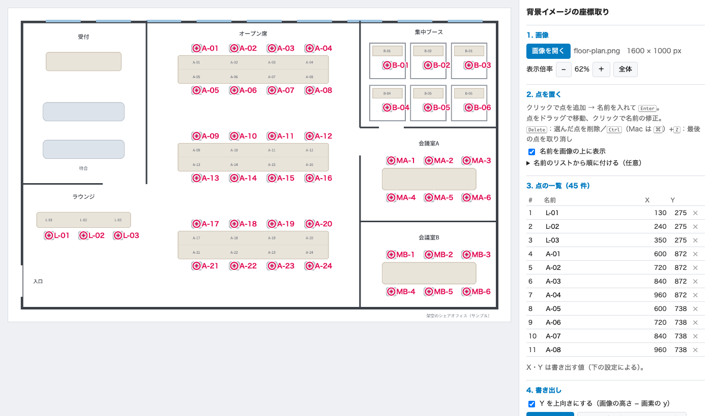
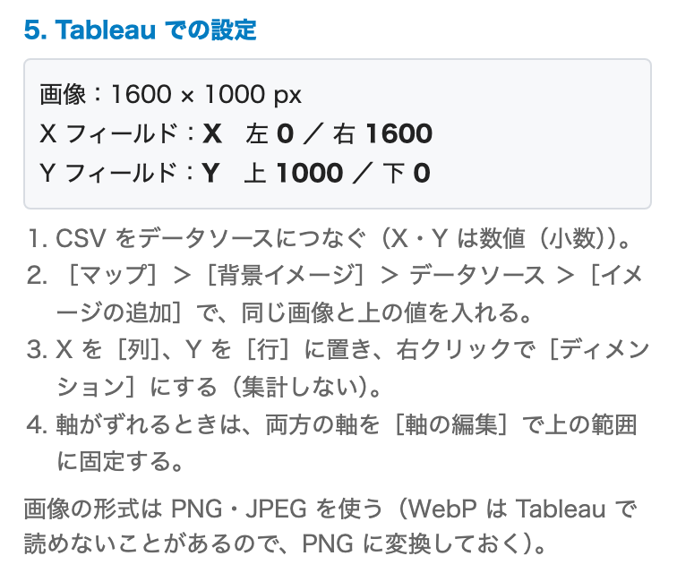
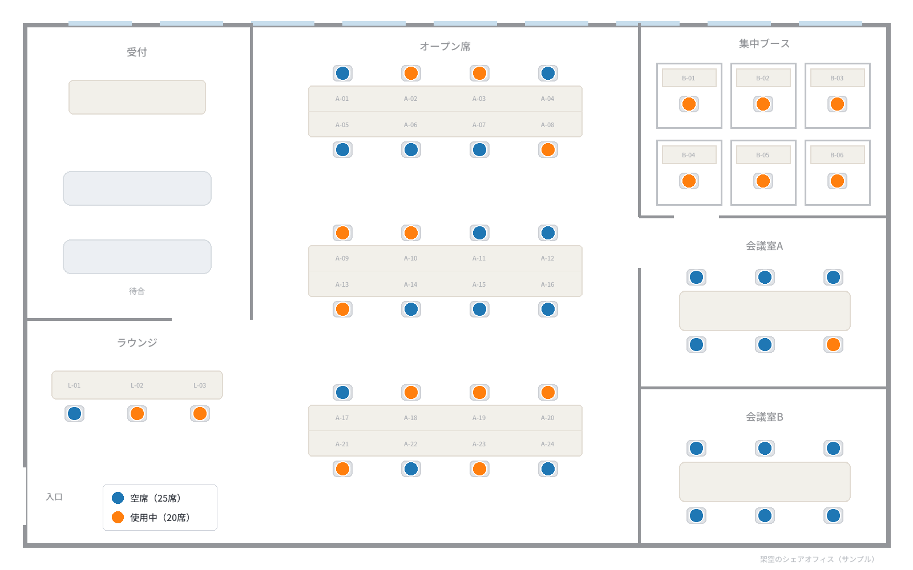

# 背景イメージの座標取り（bgimage-plotter）

Tableau の「背景イメージ」機能で使うための座標データを作成するためのツールです。画像を読み込み、画像の上をクリックして点を置いて、その X・Y 座標を CSV に書き出します。HTML ファイル1つで動くので手元でインターネットに情報を出すことなく使うことができます。

Tableau の背景イメージでは、オフィスのフロア図・店舗の売場図・工場や倉庫の設備配置図などの画像をビューの背景に敷き、その上に座席・商品棚・設備の点を重ねられます。点を置くには画像の上の X・Y 座標が要るので、このツールでその座標を作ります。

- Tableau ヘルプ：[ビューで背景イメージを使用する](https://help.tableau.com/current/pro/desktop/ja-jp/bkimages.htm)



## 特長

- **HTML ファイル1つだけ**：インストールは要りません。`index.html` を Chrome か Edge で開けば使えます。
- **外部と通信しません**：画像も点もブラウザの中だけで扱います。ページの先頭に Content-Security-Policy を書いて、外部への通信をブラウザに禁止させています（[安全性について](#安全性について)）。
- **Tableau で設定すべき値も出します**：背景イメージの設定に入れる値（左・右・上・下）を画面に表示します。座標の Y は、Tableau に合わせて上向き（画像の高さ − 画素の y）にして出します。

## 使い方

1. ツールを開きます。次のどちらでも使えます。
   - **ブラウザで開く**：<https://unbosoms.github.io/bgimage-plotter/> を Chrome か Edge で開きます。ページを読み込んだ後は、画像も点も外部に送りません。
   - **ダウンロードして開く**：[`index.html`](index.html) をダウンロードして、Chrome か Edge で開きます（ファイルをダブルクリック）。インターネットにつながっていない PC でも使えます。
2. **画像を開く**：「画像を開く」ボタン、画像のドラッグ＆ドロップ、コピーした画像の貼り付け（Ctrl＋V／Mac は ⌘＋V）のどれでも開けます。
3. **点を置く**：置きたい所をクリック → 名前を入れて Enter。
   - 点はドラッグで動かせます。点をクリックすると名前を直せます。
   - Delete で選んだ点を削除、Ctrl＋Z（Mac は ⌘＋Z）で最後の点を取り消します。
   - 「名前のリストから順に付ける」に名前を1行ずつ貼ると、クリックするたびに上から順に名前が付きます。
4. **CSV を保存**：「CSV を保存」で `画像名_座標.csv` を保存します（UTF-8、BOM 付き。Excel でそのまま開けます）。
5. **続きから作業する**：同じ画像を開いて「CSV を読み込んで続きから」で、保存した CSV を読み込みます。

### 出力する CSV の列

| 列 | 中身 |
|---|---|
| 番号 | 置いた順の番号 |
| 名前 | 点の名前 |
| X | Tableau で使う X（＝画素の x） |
| Y | Tableau で使う Y（「Y を上向きにする」がオンのとき、画像の高さ − 画素の y） |
| 画素X・画素Y | 画像の左上を原点にした画素の位置（続きから作業するときに使います） |

## Tableau での使い方

1. 出力した CSV をデータソースとしてつなぎます。
2. ［マップ］＞［背景イメージ］＞ データソースを選ぶ ＞［イメージの追加］で、ツールで開いたのと **同じ画像** を選びます。
   - X フィールド：`X`、左 `0`／右 `画像の幅`
   - Y フィールド：`Y`、上 `画像の高さ`／下 `0`
   - **入れる値は、画像を開くとツールの「5. Tableau での設定」に表示されます**。画像の幅や高さを自分で調べる必要はありません。表示された値をそのまま入れてください。

     
3. `X` を［列］、`Y` を［行］に置き、右クリックで［ディメンション］にします（集計しない）。

参考：Tableau ヘルプ「[ビューで背景イメージを使用する](https://help.tableau.com/current/pro/desktop/ja-jp/bkimages.htm)」

## サンプル：シェアオフィスの空席表示

[`sample/`](sample/) に、**架空のシェアオフィス** の座席図で試せるデータを置いています。

| ファイル | 中身 |
|---|---|
| [`floor-plan.png`](sample/floor-plan.png) | 座席図（1600×1000 px）。ラウンジ・オープン席・集中ブース・会議室の 45 席 |
| [`seats.csv`](sample/seats.csv) | このツールで座席の点を置いた CSV（名前＝座席ID） |
| [`seat-status.csv`](sample/seat-status.csv) | 座席ごとの利用状況（座席ID・エリア・状況）。架空のデータ |
| [`preview.png`](sample/preview.png) | できあがりのイメージ |



Tableau では次のように作ります。

1. `seats.csv` と `seat-status.csv` をつなぎ、**リレーションシップ** で `名前` ＝ `座席ID` を結びます。
2. 上の「Tableau での使い方」のとおり背景イメージを設定します（左 0／右 1600、上 1000／下 0）。
3. `状況` を［色］に置くと、空席と使用中が色で分かれます。［背景イメージ］の「ウォッシュアウト」で画像を薄くすると、点が見やすくなります。
4. `エリア` と `状況` で集計すると、エリアごとの空席数や「満席」のエリア（サンプルでは集中ブース）が分かります。

実際の運用では、`seat-status.csv` の代わりに予約システムや入退室の記録などのデータを座席IDで結びます。

## 安全性について

- **外部と通信しません**。ページの先頭の Content-Security-Policy で、外部のサーバーへの通信・外部の画像やスクリプトの読み込み・フォームの送信をすべて禁止しています。画像は手元のファイルか貼り付けたものを、ブラウザの中だけで読みます。
- **点はブラウザに保存されます**。作業の途中で閉じても続きから再開できるよう、点の位置と名前をブラウザの保存領域（localStorage）に残します。画像そのものは保存しません。共用の PC では、作業の後に「すべて消す」を押してください。
- **CSV の数式対策**：名前が `=` `+` `-` `@` で始まるときは、Excel で数式として動かないよう、先頭に `'` を付けて書き出します（読み込むときは外します）。
- **改変されていないか確かめる**：このリポジトリから取得したファイルを使ってください。リリースに載せる SHA-256 の値と、手元のファイルの値が同じかを確かめられます。

  ```bash
  # Mac
  shasum -a 256 index.html
  ```

  ```powershell
  # Windows（PowerShell）
  Get-FileHash index.html -Algorithm SHA256
  ```

## 動作環境

- Chrome・Edge の最新版で確かめています。
- 画像は PNG・JPEG を使ってください（Tableau で使う画像と同じファイル）。

## ライセンス

[MIT License](LICENSE)

Tableau は Salesforce, Inc. の商標です。このツールは個人の制作物で、Salesforce, Inc. とは関係ありません。
